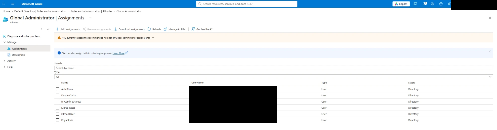

# Azure Identity Audit

Built a lab Microsoft Entra ID tenant, planted 8 realistic identity mistakes, found them by hand and wrote a read-only PowerShell/Microsoft Graph tool that checks for them automatically.

**📄 [Read the audit report](reports/AUDIT-REPORT.md)**: 9 findings (2 Critical, 5 High, 2 Medium) with screenshot evidence, an attack chain and a remediation plan.

> **Status:** lab built ✅ · manual audit in the portal ✅ · automated BEFORE run ⏳ · remediation ⏳ · AFTER re-audit ⏳

## What this is

I built a small Entra ID tenant for a fictional company, *Northwind Bakery*, with 12 staff, 3 department groups, a vendor guest and an inventory app. Then I planted 8 identity mistakes of the kind real audits find, audited the tenant by hand in the Azure portal, and wrote a script that runs the same checks automatically.

| Script | What it does | Changes the tenant? |
|---|---|---|
| [`seed-lab.ps1`](seed-lab.ps1) | Creates the lab company with 8 planted mistakes | Yes (lab only) |
| [`audit-identities.ps1`](audit-identities.ps1) | Runs 9 checks and writes `findings.csv`, `findings.json`, `report.md` | **No, read-only** |
| [`cleanup-lab.ps1`](cleanup-lab.ps1) | Removes everything the seed script created (`-WhatIf` to preview) | Yes (lab only) |

## Key findings

| Severity | Finding |
|---|---|
| 🔴 Critical | MFA not enforced: security defaults off, no Conditional Access |
| 🔴 Critical | Global Admins with no usable MFA method |
| 🟠 High | 6 Global Admins; Microsoft recommends fewer than 5 |
| 🟠 High | Shared "IT Admin (shared)" account with Global Admin |
| 🟠 High | Vendor guest account holding User Administrator |
| 🟠 High | App with `Directory.ReadWrite.All` (application) |
| 🟠 High | Standard users with no usable MFA |
| 🟡 Medium | Leaver account still enabled |
| 🟡 Medium | App client secret valid for 2 years |

The leaked-secret + over-permissioned-app combination is a full tenant compromise path. See [the attack chain](reports/AUDIT-REPORT.md#4-attack-chain-how-the-findings-combine).



## What doing it by hand taught me

- **Registered isn't the same as usable.** A test user had a phone number registered, but the portal listed it as *"Disabled by policy"*: new tenants turn SMS off. My first script version would have counted that user as protected. I changed check ID-05 to compare registered methods with the tenant's Authentication methods policy.
- **One portal view isn't enough.** The guest's *Assigned roles* page failed to load. Checking from the role side found the assignment. The script reads role assignments straight from Microsoft Graph, so it doesn't depend on that page.
- **An empty sign-in log proves nothing.** On the Free tier, logs go back 7 days and last-sign-in data needs P1, so a leaver and a new hire look identical. The script finds leavers by department and checks inactivity only when the licence allows.

## Checks

| Check | Looks for | Planted mistake |
|---|---|---|
| ID-01 | More than 4 (or fewer than 2) enabled Global Admins | 1 |
| ID-02 | Guests holding privileged roles | 2 |
| ID-03 | Shared / generic accounts holding privileged roles | 7 |
| ID-04 | Enabled leavers; no sign-in in 90 days (needs P1/P2) | 3 |
| ID-05 | Members with no **usable** MFA method (Critical if admin and MFA isn't enforced) | 4 |
| ID-06 | App secrets valid more than 365 days, or expired | 5 |
| ID-07 | Tenant apps holding high-risk Graph application permissions | 6 |
| ID-08 | Security defaults off and no Conditional Access requiring MFA | 8 |
| AZ-01 | Owner / User Access Administrator assigned directly to a user | 9 (optional) |

## Before / after

Coming after remediation: the summary tables from the automated BEFORE and AFTER runs, generated with `-Baseline`. The goal is 0 Critical and 0 High.

## Limits

- On the Free tier there is no sign-in activity or Conditional Access, so ID-04 only finds leavers by department and ID-08 only checks security defaults. The P2 trial lifts both limits.
- Only active role assignments are checked unless P2 is present; PIM-eligible admins are invisible on Free.
- Privileged roles held through groups are counted, but group members are not expanded.
- ID-05 checks whether a usable MFA method is registered, not whether MFA was actually used at sign-in.

## What I'd do next

- Conditional Access policies instead of security defaults (MFA for all, block legacy auth)
- PIM for just-in-time admin and time-boxed vendor access
- Run the audit on a schedule and alert on new Critical/High findings

## Run it yourself

Only in a directory you own. Running this against a school or employer tenant without written permission is unauthorized access, even read-only. Works in PowerShell 7 and Windows PowerShell 5.1.

```powershell
Install-Module Microsoft.Graph -Scope CurrentUser
Install-Module Az.Accounts, Az.Resources -Scope CurrentUser   # only for AZ-01

pwsh ./seed-lab.ps1 -TenantId <tenant-id> -GuestEmail "other.email@example.com"
pwsh ./audit-identities.ps1 -TenantId <tenant-id> -OutDir ./audit-BEFORE
# ...fix findings...
pwsh ./audit-identities.ps1 -TenantId <tenant-id> -OutDir ./audit-AFTER -Baseline ./audit-BEFORE/findings.json
pwsh ./cleanup-lab.ps1 -TenantId <tenant-id> -GuestEmail "other.email@example.com" -WhatIf
```

Raw audit output (`audit-*/`) and the seed answer key (`lab-manifest.json`) are git-ignored, because they contain tenant IDs and usernames. Scrub reports before committing them.
