# Entra ID Identity Audit: Northwind Bakery (lab)

| | |
|---|---|
| **Auditor** | Tuan Anh Pham |
| **Date** | November 11, 2026 |
| **Environment** | Lab Microsoft Entra ID tenant (Entra ID Free), personal Azure account |
| **Scope** | Directory roles, guest access, account lifecycle, MFA, app registrations, tenant MFA enforcement |
| **Method** | Manual review in the Azure portal (Phase 2), to be confirmed by the automated audit script |
| **Status** | Manual audit complete. Automated BEFORE run, remediation and AFTER run still to do |

> All data in this report comes from a lab tenant built for this project. The company, staff and app are fictional. Usernames, object IDs and email addresses are redacted in the screenshots.

---

## 1. Executive summary

I reviewed a small Microsoft Entra ID tenant for a fictional 12-person company and found **8 identity weaknesses**. Taken together they mean **one stolen password or one leaked app secret could hand an attacker full control of the directory**:

- **Nothing forces MFA.** Security defaults are off and there are no Conditional Access policies, so every account, including 6 Global Admins, signs in with a password alone.
- **Too many people hold the keys.** 6 accounts are Global Administrator, including a shared login nobody is accountable for. An outside vendor's guest account can reset staff passwords.
- **A background app can rewrite the directory.** The Inventory-Sync app holds `Directory.ReadWrite.All` as an application permission and authenticates with a secret valid for 2 years.

| Severity | Count | Findings |
|---|---|---|
| 🔴 Critical | 2 | F-1 MFA not enforced · F-2 Admins with no usable MFA |
| 🟠 High | 5 | F-3 Too many Global Admins · F-4 Shared admin account · F-5 Guest with admin role · F-6 Over-permissioned app · F-7 Standard users with no usable MFA |
| 🟡 Medium | 2 | F-8 Leaver still enabled · F-9 Long-lived app secret |

The fixes are mostly configuration changes that cost nothing on the Free tier. Turning security defaults back on closes the two Critical findings at once.

---

## 2. Scope and method

**In scope:** the lab tenant's users, guests, groups, directory role assignments, app registrations and enterprise apps, the Authentication methods policy and security defaults.

**Out of scope:** Azure subscription RBAC (optional check AZ-01, not planted for this run), Microsoft 365 workloads, device compliance, and any tenant other than the lab. Running this audit against a school or employer tenant without written permission would be unauthorized access.

**How:**
1. `seed-lab.ps1` built the tenant with 8 deliberately planted mistakes. The planted list was written down first as an answer key.
2. Each check was performed **by hand in the Azure portal**, with screenshots as evidence (this report).
3. `audit-identities.ps1` repeats the same checks automatically and read-only through Microsoft Graph. Its output will be compared against this manual review.

**Severity scale**

| Severity | Meaning |
|---|---|
| Critical | Direct path to tenant takeover with a single stolen credential |
| High | Significant privilege or exposure; exploitable with one more step |
| Medium | Weakens defence in depth or lifecycle hygiene |
| Low / Info | Best-practice gap, or already mitigated |

---

## 3. Findings

### F-1 🔴 Critical: MFA is not enforced anywhere (check ID-08, planted #8)

**What I found:** security defaults are **disabled** (Entra ID → Overview → Properties → Manage security defaults), and there are **no Conditional Access policies**. The Free tier cannot create Conditional Access policies, so security defaults are the only tenant-wide MFA control available.

**Why it matters:** with nothing enforcing MFA, a phished or reused password is enough to sign in as anyone, including a Global Admin. This is the root cause behind F-2 and F-7.

**Fix:** turn security defaults back on. One switch requires every user to register MFA and every admin to use it at each sign-in. With a P1 licence, replace it with Conditional Access policies (MFA for all users, block legacy authentication).

**Security+ link:** baseline hardening, MFA.

> Evidence: the security defaults setting was switched off by hand after seeding. Screenshot of the Properties page to be added.

---

### F-2 🔴 Critical: Global Admins have no usable MFA method (ID-05, planted #4)

**What I found:** the Global Admin **Olivia Baker (nw.owner)** has **no authentication methods at all**: "No usable methods" and "No non-usable methods". The other seeded Global Admins were created the same way, with a password only.

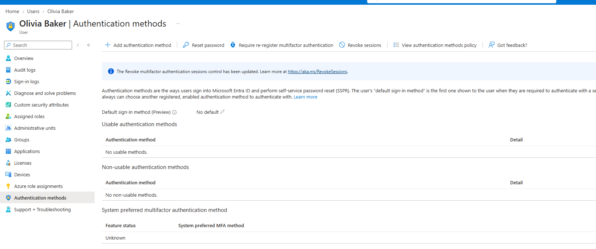

**Why it matters:** a Global Admin with password-only sign-in is the single most valuable target in the tenant. Combined with F-1, nothing stops an attacker who has the password.

**Fix:** enable security defaults (F-1), then have each admin register Microsoft Authenticator or a FIDO2 key. Reduce the number of admins first (F-3) so fewer accounts need protecting.

**Security+ link:** MFA, credential attacks (phishing, password spraying, credential stuffing).

---

### F-3 🟠 High: Too many Global Administrators (ID-01, planted #1)

**What I found:** **6 accounts** hold Global Administrator: my own admin account, nw.owner, nw.manager, nw.dev, nw.accounts and it-admin-shared. The portal itself warns: *"You currently exceed the recommended number of Global administrator assignments."*

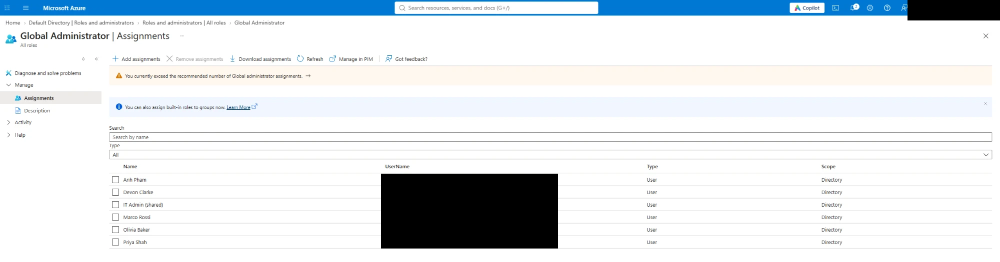

**Why it matters:** each Global Admin can change every setting, read any data and create more admins. Microsoft recommends fewer than 5. A 12-person bakery needs 2: one daily admin and one break-glass account.

**Fix:** keep my admin account plus one break-glass account (long random password stored offline, used only in emergencies). Move nw.dev to **User Administrator**, the narrower role the job needs, and remove the role from the others.

**Security+ link:** least privilege.

---

### F-4 🟠 High: Shared admin account (ID-03, planted #7)

**What I found:** **IT Admin (shared)** (`it-admin-shared`) is an **enabled** member account holding **Global Administrator**, assigned **directly** (not through a group or PIM). It has no first or last name, and its job title is "Shared IT account".

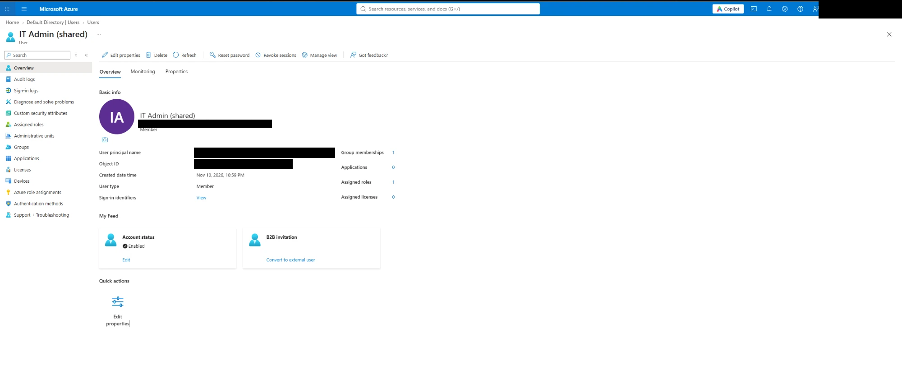

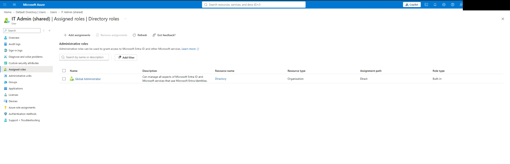

**Why it matters:** when several people share one login, the audit log can only say "it-admin-shared did it", never *who* did it. That breaks **accountability and non-repudiation**: no one can be held responsible for an admin action, and a departing employee keeps working credentials unless the password is changed for everyone.

**Fix:** disable the account and remove its role. Give each admin a named account. For temporary elevation, use PIM (P2) so admin rights are just-in-time and logged per person.

**Security+ link:** non-repudiation, accountability, account management.

---

### F-5 🟠 High: Guest account holds an admin role (ID-02, planted #2)

**What I found:** the guest **Vendor (Northwind POS support)**, an external personal email account, holds **User Administrator** at **Directory** scope.

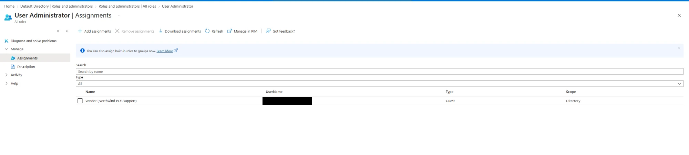

Note: the guest's own *Assigned roles* page failed to load ("There was an error retrieving directory roles"), most likely because the invitation is still pending. I confirmed the assignment from the role's side instead. The audit script reads role assignments straight from Microsoft Graph, so it doesn't depend on that page.

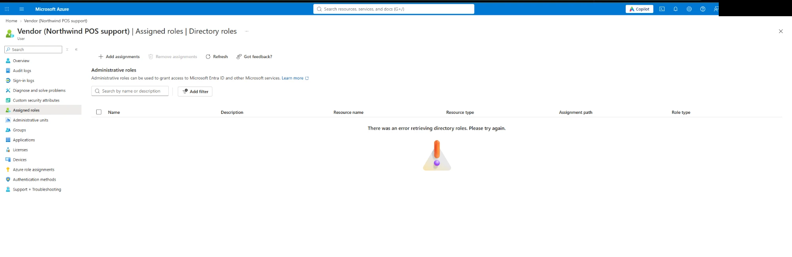

**Why it matters:** User Administrator can create and delete users, reset non-admin passwords and manage groups. An outside party's personal account, outside our control and our MFA policy, can do that across the whole directory. If the vendor is phished, so are we.

**Fix:** remove the role. If the vendor needs admin access, make it **time-boxed and approved** with PIM eligibility (P2), or scope it to an administrative unit.

**Security+ link:** third-party and supply-chain risk, least privilege.

---

### F-6 🟠 High: App holds a tenant-wide write permission (ID-07, planted #6)

**What I found:** the **Inventory-Sync** app has **Microsoft Graph → Directory.ReadWrite.All**, type **Application**, with admin consent **granted**.

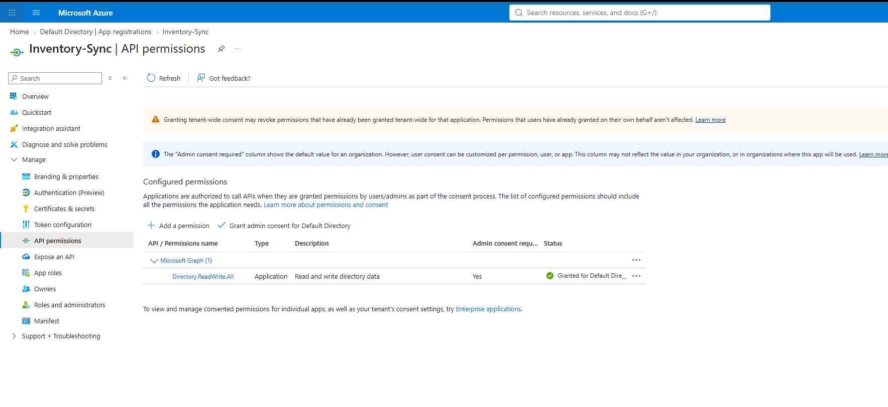

**Why it matters:**
- *Application* type means the app acts on its own, with no signed-in user and no MFA.
- *Directory.ReadWrite.All* lets it read and change almost every directory object: users, groups and other apps.
- An inventory sync needs, at most, to **read** users.

**Fix:** remove `Directory.ReadWrite.All` and grant `User.Read.All` (application), the permission the app actually needs.

**Security+ link:** least privilege for service accounts.

---

### F-7 🟠 High: Standard users have no usable MFA, including one with a phone registered (ID-05, planted #4)

**What I found:**
- **Grace Kim (nw.sales1)** has no authentication methods.

  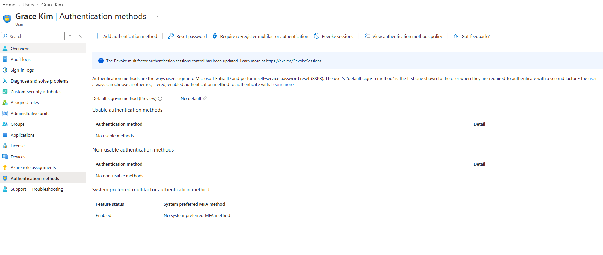

- **Sam Lee (nw.baker1)** *does* have a phone number registered, but it is listed under **Non-usable authentication methods: "Disabled by policy"**. New tenants turn SMS and voice off in the Authentication methods policy, because SMS codes can be intercepted. Sam is therefore no better protected than Grace.

  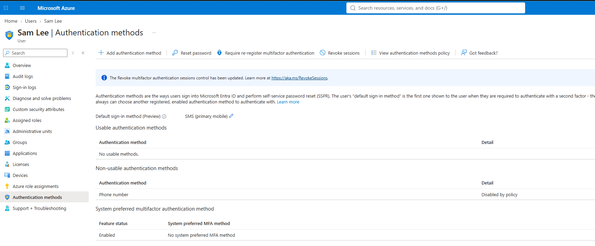

**Why it matters:** password-only accounts are the usual entry point for phishing and password spraying. Sam's case shows that **"MFA method registered" is not the same as "protected"**.

**Fix:** enable security defaults (F-1) and have users register Microsoft Authenticator, which is enabled in the policy. Do not re-enable SMS just to make Sam's phone count.

**Security+ link:** MFA, authentication factors.

**Tool improvement found during this review:** the first version of `audit-identities.ps1` counted any *registered* MFA method, so it would have passed Sam. I changed check ID-05 to read the tenant's Authentication methods policy and count only methods whose type is enabled. Users like Sam are now reported as *"MFA method registered but disabled by policy"*. This is the kind of gap a manual review catches and an automated tool can then keep catching.

---

### F-8 🟡 Medium: Leaver account still enabled (ID-04, planted #3)

**What I found:** **Jamie Leaver (j.leaver)**, department **"Former staff"**, has **Account status: Enabled** and is still a member of 1 group (NW-Bakery).

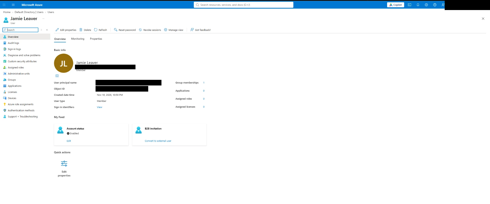

The sign-in logs show no sign-ins. On the **Free tier**, sign-in logs only go back **7 days**, and the per-user "last sign-in" data that would reveal a long-unused account needs **P1/P2**. An empty log can't tell a leaver from a new hire who hasn't signed in yet, so the audit identifies leavers by department and only checks inactivity when the licence allows.

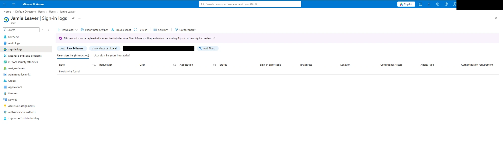

**Why it matters:** an enabled leaver account is an open door. If the password was reused or phished, a former employee or an attacker can still sign in, and nobody is watching the account.

**Fix:** disable the account the day the person leaves, remove group memberships and roles, and record the date. Delete it after the retention period.

**Security+ link:** account lifecycle, offboarding.

---

### F-9 🟡 Medium: App secret valid for 2 years (ID-06, planted #5)

**What I found:** Inventory-Sync has one client secret, `inventory-sync-2yr`, that **expires 11/10/2028**. It has no certificates and no federated credentials. The portal itself recommends *"using a certificate (instead of a client secret)"*.

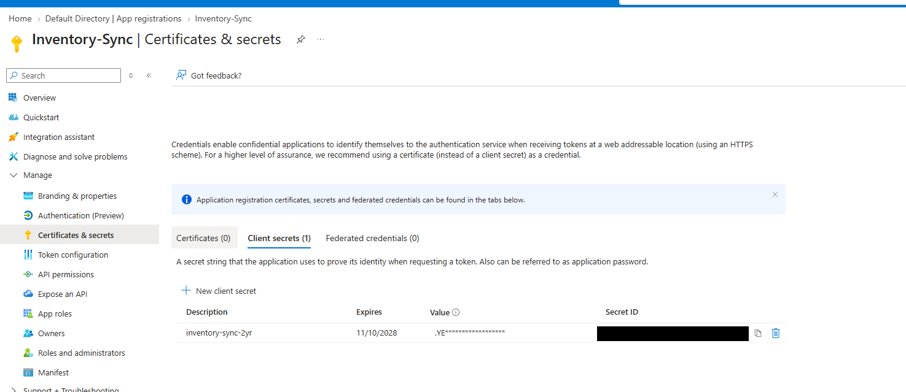

**Why it matters:** a client secret is a password for an app. If it leaks in a commit, a log or a config file, it stays valid for two years.

**Fix:** delete the 2-year secret and add one valid for **6 months or less**. Better still, use a certificate, or a managed identity / federated credential so there is no secret to leak at all.

**Security+ link:** secrets management, key rotation.

---

## 4. Attack chain: how the findings combine

Individually F-6 and F-9 are High and Medium. **Together they are a tenant compromise:**

```
Leaked 2-year client secret (F-9)
   -> sign in as Inventory-Sync, no user and no MFA involved
   -> Directory.ReadWrite.All (F-6)
   -> add a new account to a privileged group, reset credentials, add secrets to other apps
   -> persistent control of the directory
```

A second chain runs through people: a phished password for any of the 6 Global Admins (F-3, F-4) works on its own, because nothing enforces MFA (F-1, F-2).

Fixing **F-1 first** breaks the people chain. Fixing **F-6 and F-9** breaks the app chain.

---

## 5. Remediation plan

In severity order, matching Phase 3 of the project:

| # | Fix | Closes | Effort |
|---|---|---|---|
| 1 | Turn security defaults on | F-1, and forces MFA registration for F-2 / F-7 | 1 min |
| 2 | Cut Global Admins to 2 (mine + break-glass); move nw.dev to User Administrator | F-3 | 10 min |
| 3 | Disable it-admin-shared and remove its role | F-4 | 2 min |
| 4 | Remove the guest's User Administrator role | F-5 | 1 min |
| 5 | Replace Directory.ReadWrite.All with User.Read.All on Inventory-Sync | F-6 | 5 min |
| 6 | Rotate the app secret to 6 months (or a certificate) | F-9 | 5 min |
| 7 | Disable j.leaver, remove group memberships, record the date | F-8 | 2 min |

**Target:** a re-audit showing **0 Critical and 0 High**, with each fix listed in the before/after table generated by:

```powershell
pwsh ./audit-identities.ps1 -TenantId <tenant-id> -OutDir ./audit-AFTER -Baseline ./audit-BEFORE/findings.json
```

---

## 6. Limits of this review

- **Free tier:** no per-user sign-in activity and no Conditional Access, so inactivity (ID-04) and policy-based MFA (ID-08) can only be checked in reduced form. The Entra ID P2 trial lifts both limits.
- **Active roles only:** without P2/PIM there are no "eligible" role assignments to review. In a real tenant, eligible admins must be counted too.
- **Groups:** roles assigned to groups are counted, but group members are not expanded.
- **MFA:** the review checks which methods are registered and allowed by policy, not whether MFA was actually used at each sign-in. Guests' MFA is controlled by their home tenant.
- **Azure RBAC:** the optional subscription check (AZ-01) was not part of this run.

---

## 7. Next steps

1. Add the security-defaults screenshot (F-1).
2. Run `audit-identities.ps1` (BEFORE) and compare its findings with this manual review.
3. Apply the remediation plan, then run the AFTER audit with `-Baseline`.
4. Add the before/after summary to the README.
5. Run `cleanup-lab.ps1` (preview with `-WhatIf` first) and turn security defaults back on.
